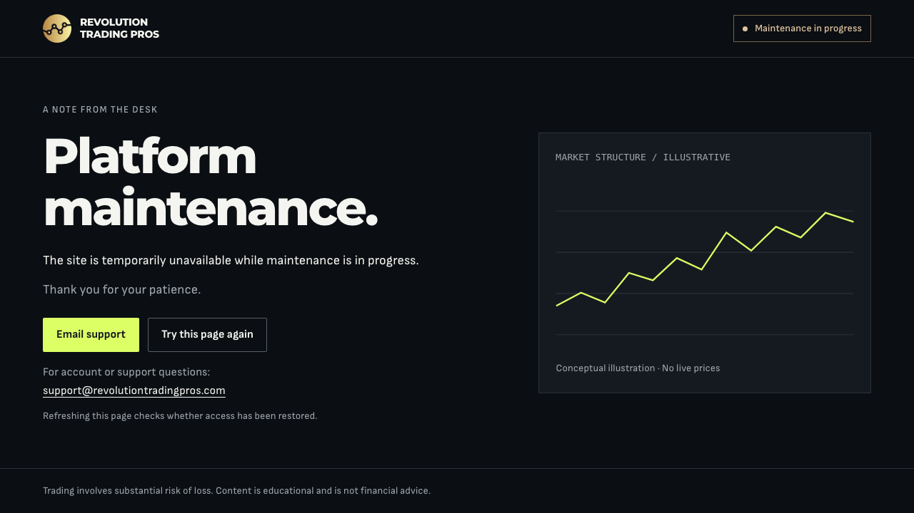

# Maintenance desk notice implementation

Implemented November 3, 2026, following [the design review](REVIEW.md). This document records implementation evidence; the original review and wireframe remain the historical proposal.

## Delivered behavior

- A compact notice with the existing square gold emblem, Montserrat Variable heading, Sofia Sans Variable copy, acid support action and amber maintenance status.
- Direct native email support and a visible, wrapping address. The repeated promotional/contact section and indefinite chart pulse are removed.
- A static SVG chart in a separate panel on tablet/desktop, explicitly labeled as illustrative, hidden below 768 px.
- A real document retry that preserves path/query, prevents repeated activation while reloading and resets on `pageshow`. With JavaScript disabled, refresh instructions replace the button and support remains usable.
- Content-driven mobile layout, explicit main focus target, visible focus rings, reduced-motion behavior from the canonical root CSS, and a skip link that stays fully hidden until focus even with enlarged text.
- The same deployment switch, HTTP 503/no-store response functions, client-navigation check and route exceptions as before.

## Files and architecture

- `scripts/templates/maintenance.html` owns the emergency document, scoped maintenance styles and the small document-lifetime retry script. It does not hydrate Svelte or create charts, timers or subscriptions.
- `scripts/maintenance-build.mjs` resolves the root CSS through the current Vite manifest, embeds it, rebases its asset URLs and embeds `static/icon-192.png`. Fontsource imports and tokens stay in `src/app.css`. Referenced assets and every template token are checked before output is written. No new dependencies were added.
- The build creates `/maintenance/index.html` in the client and Vercel output for review, and the enabled response function uses that same generated HTML. The unprocessed template is no longer a public static file.
- `tests/maintenance/build-output.test.mjs` covers normal/active routing and functions, including status, cache headers, HEAD, API/health/assets and generated theme/emblem handling. `tests/maintenance/navigation.e2e.ts` covers client navigation, mobile/reduced motion, keyboard focus, retry/recovery and the no-JavaScript/font-failure case.
- `docs/MAINTENANCE.md` contains the operating instructions. The switch remains `MAINTENANCE_MODE=true` during a new Vercel build; remove it or set it to `false` and create another deployment to deactivate. Setting the variable alone does not update an existing deployment.

## Verification

| Check                                                                               | Result                                                                                                                                                               |
| ----------------------------------------------------------------------------------- | -------------------------------------------------------------------------------------------------------------------------------------------------------------------- |
| `pnpm check:css`                                                                    | Passed; all source CSS tokens declared. The maintenance build separately validates the HTML template's tokens against the compiled root CSS.                         |
| `pnpm check`                                                                        | Passed: 0 errors, 0 warnings. No Svelte files changed in this implementation; Svelte MCP tools remain unavailable.                                                   |
| `pnpm check:pages`                                                                  | All 47 prerendered pages passed.                                                                                                                                     |
| `node --test tests/maintenance/build-output.test.mjs`                               | 2 tests passed.                                                                                                                                                      |
| `pnpm test:unit --run`                                                              | 70 files / 520 tests passed.                                                                                                                                         |
| `pnpm exec playwright test tests/maintenance/navigation.e2e.ts --browser=all`       | 15 tests passed across Chromium, Firefox and WebKit, including the final scoped skip-link styling.                                                                   |
| `pnpm exec playwright test`                                                         | Final run: 22 passed, 13 skipped, including the configured SEO checks and the final enlarged-text skip-link styling.                                                 |
| `MAINTENANCE_MODE=true pnpm build` and normal `pnpm build`                          | Both variants built successfully. Existing large-chunk and optional dependency-tracing warnings remain. Normal output was restored after inspection.                 |
| Changed-file formatter, `pnpm exec vp lint .`, Svelte ESLint and `git diff --check` | Passed; code lint reports existing warnings outside the changed files.                                                                                               |
| `pnpm lint`                                                                         | Stops at existing formatting issues in review evidence JSON and root prompt Markdown files. These unrelated files were left unchanged. It is not recorded as passed. |

WebKit keyboard tests use Option-Tab for links, matching [Apple's documented Safari shortcut](https://support.apple.com/guide/safari/keyboard-shortcuts-and-gestures-cpsh003/mac). The initial all-engine run exposed the tests' assumption that plain Tab selects links under every browser's default preferences. The assertions remain the same; the test now uses each engine's link-navigation shortcut.

A final sandboxed pnpm invocation switched stores and attempted an unsuccessful registry fetch, leaving `node_modules` incomplete. `pnpm install --frozen-lockfile --offline` restored all 636 locked packages from the existing store with zero downloads and no manifest or lockfile changes. Type, page, unit and full browser checks were rerun successfully afterward.

The generated enabled function was also served through a local Node harness, with real immutable font assets from the same build. Root and nested requests returned 503 and no-store. The page loaded only the two upright Latin WOFF2 faces it needed, both same-origin with status 200. No JavaScript page errors or failed resource requests were observed. A browser may log the expected HTTP 503 document status; this is not a hydration failure.

The harness is not Vercel's CDN/router. Lifecycle browser tests model activation through intercepted responses; generated routing/function tests check the deployment artifacts. A real Vercel preview remains required for deployed edge routing, caching and any project-level deployment behavior. Nothing was deployed or published.

## Visual evidence

- [320 px](implemented/320.png), [390 px](implemented/390.png), [tablet](implemented/768.png), [short laptop](implemented/1280.png), [desktop](implemented/1440.png), [keyboard focus](implemented/focus.png), [doubled-text stress test](implemented/text-enlarged-320.png).
- [Runtime measurements](implemented/runtime.json) record ten widths: 320, 360, 390, 480, 640, 768, 1024, 1280, 1440 and 1536 px. All had zero horizontal overflow. The primary support action fits at 320×568; support details fit at 390×844 and 1280×720.
- [Visual comparison measurements](implemented/comparison.json): doubling informational text sizes at 320 px retained zero horizontal overflow, with vertical scrolling; this is a CSS text-enlargement stress test, not a claim about browser zoom or assistive-technology certification.
- The normal homepage at 1280×720 had **0 differing pixels out of 921,600** compared with the review baseline under the same reduced-motion/font-ready conditions. The intentional maintenance redesign is documented by the before/after screenshots rather than a zero-difference target.

