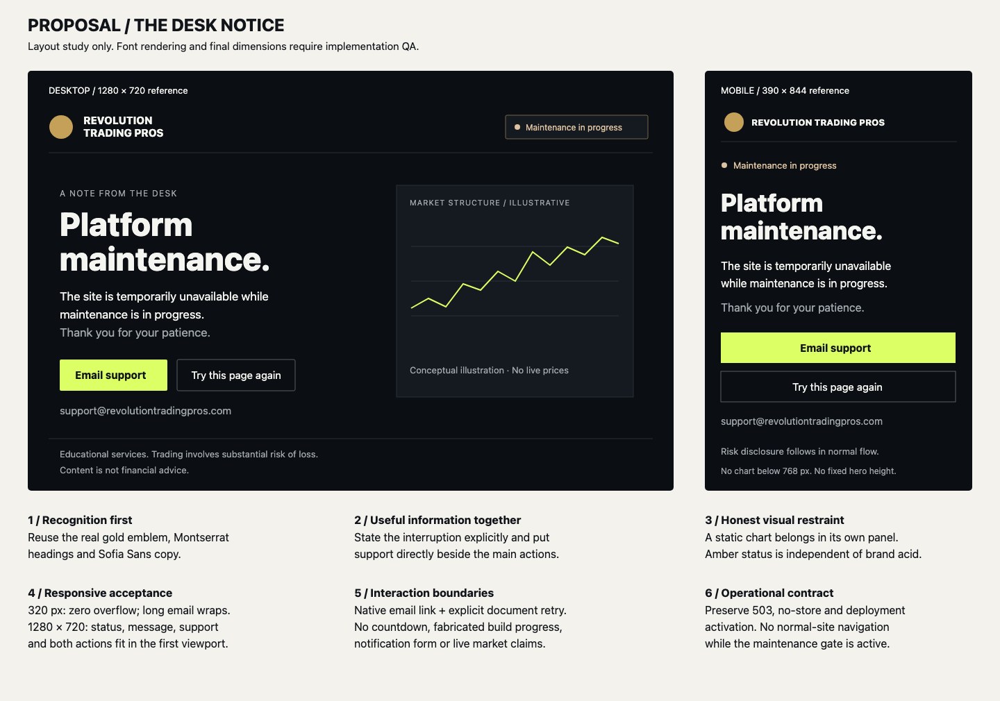

# Maintenance experience: design review and proposal

**Audit date:** November 3, 2026, America/New_York. **Scope:** audit and proposal only, as requested in `improve-layout-prompt.md`. No application code was changed in this audit. Screenshots show the implemented page; the wireframe shows a proposal.

## Recommendation

Build a compact **desk notice** using Revolution Trading Pros' existing emblem, Montserrat/Sofia Sans typography, dark surfaces, acid primary action and amber maintenance status. Put the interruption, useful action and support address together. Keep one static, explicitly illustrative chart in a separate desktop panel; remove it on phones. Remove the second promotional section and the indefinite decorative pulse.

The current page clearly communicates an interruption, has strong foreground contrast, uses honest chart labeling and has a functioning support path. Its principal weaknesses are a verified 320 px overflow defect, a visual identity that differs from the surrounding site, and a large hero that separates the notice from the actual support address. These can be addressed without changing maintenance activation or response behavior.

## What was inspected

The installed dependencies are Svelte **5.57.3**, SvelteKit **3.1.1**, and adapter-vercel **7.0.2**, confirmed with `pnpm list ... --depth 0`. Read the repository instructions, CSS standards, page playbook, current maintenance runbook, standalone HTML, build script, root layout, homepage hero, navbar and SSOT stylesheet.

Ran `MAINTENANCE_MODE=true pnpm build`: **exit 0**, with existing chunk-size/dependency-tracing warnings. Opened the emitted `__maintenance_page` function through a temporary local HTTP harness on port 4317 that selects the generated maintenance routing rules. This exercised the **enabled build artifact**, including HTTP 503 and `no-store`, rather than the ordinary `/maintenance/index.html` preview. The normal site on port 4173 supplied the brand comparison. This harness does not implement Vercel's full router, CDN or deployment behavior; those remain outside this design audit. After inspection, stopped both local servers and ran `pnpm build`: **exit 0**, restoring normal generated routing. Review formatting, local artifact links and SVG XML validation passed. Application tests were not rerun because this audit changed only review artifacts.

Chromium inspection covered 320×568, 390×844, 768×1024, 1280×720 and 1440×900, plus keyboard activation, pointer hover, normal motion and reduced motion. All maintenance responses inspected returned 503 and `Cache-Control: no-store, max-age=0`. No failed network requests or JavaScript page errors were recorded; the maintenance document needed no external resources. Chromium did log the expected document HTTP 503 error. A separate 1.5-second, unthrottled local observation recorded CLS 0 and first contentful paint at 24 ms; this is a local observation, not a production performance benchmark or an animation frame-rate profile. See [rendering measurements](evidence/rendering.json). This is not a cross-browser or assistive-technology certification.

### Evidence

| Viewport | Document width × height | Support panel top | Email top | Observation                                                  |
| -------- | ----------------------- | ----------------- | --------- | ------------------------------------------------------------ |
| 320×568  | **358×1541**            | 1060 px           | 1227 px   | 38 px horizontal overflow; first CTA ends near 569 px        |
| 390×844  | 390×1522                | 1060 px           | 1227 px   | No page overflow; address below the first viewport           |
| 768×1024 | 768×1257                | 877 px            | 1043 px   | Address starts below the tablet viewport; chart crosses copy |
| 1280×720 | 1280×1222               | 827 px            | 967 px    | Notice is visible; address requires scrolling                |
| 1440×900 | 1440×1352               | 937 px            | 1077 px   | Large headline and decorative area dominate the first screen |

Evidence files: [320 px](evidence/mobile-320.png), [390 px](evidence/mobile-390.png), [tablet](evidence/tablet-768.png), [short laptop](evidence/laptop-1280.png), [desktop](evidence/desktop-1440.png), [homepage comparison](evidence/brand-home-1280.png), [keyboard skip](evidence/keyboard-skip.png), [keyboard contact](evidence/keyboard-contact.png), and [raw measurements](evidence/runtime.json). Coordinates are measured from document top at initial scroll position; the screenshots are full-page captures, so the table identifies the first-viewport boundary.

## Findings and preservation priorities

### Preserve

- The initial viewport identifies maintenance, gives a short explanation, and avoids prices, progress percentages and a countdown. A five-second heuristic review found the interruption understandable; no participant usability study was performed.
- The chart caption says it is illustrative. The SVG is decorative to assistive technology and cannot be mistaken for an interactive control.
- The native support email is useful without an API or subscription service. Its `mailto:` destination matches the existing contact page's address. Mail delivery and ownership were not tested.
- Keyboard order is skip link → contact CTA → email. Focus rings are visible at 3 px. Enter on the skip link moves the viewport to main and the next Tab reaches the CTA; Enter on the CTA reaches the contact section. Chromium leaves `document.activeElement` on `body` after fragment navigation, but sequential navigation continues correctly. Do not report this as a proven skip-link failure.
- Reduced motion changes the chart animation from a four-second infinite pulse to `none`.
- Simple foreground/background pairs have ample calculated contrast: primary text ≈16.7:1, body copy ≈13.1:1, gold link on page background ≈12.1:1, dark button text on gold ≈8.3:1. These calculations do not audit every composited pixel behind the chart.

### Prioritized change matrix

Priority definitions: **P1** is required before design sign-off; **P2** completes brand and interaction quality; **P3** is optional. Effort is engineering time after approval, excluding external service procurement.

| ID / priority | Observed issue                                                                                                                                                                                                               | Proposed change                                                                                                                                                                      | User / brand benefit                                                 | Affected area                                                                     | Effort                                   | Measurable acceptance                                                                                                                                                                                                            |
| ------------- | ---------------------------------------------------------------------------------------------------------------------------------------------------------------------------------------------------------------------------- | ------------------------------------------------------------------------------------------------------------------------------------------------------------------------------------ | -------------------------------------------------------------------- | --------------------------------------------------------------------------------- | ---------------------------------------- | -------------------------------------------------------------------------------------------------------------------------------------------------------------------------------------------------------------------------------- |
| F1 / P1       | At 320 px, the email's intrinsic width expands its grid item and the page to 358 px. The support panel itself exceeds its available column.                                                                                  | Give grid children `min-inline-size: 0`; allow the address to wrap with `overflow-wrap: anywhere`; use a single mobile column.                                                       | Support remains readable without sideways scrolling.                 | `static/maintenance/index.html`: `.section`, `.panel`, email anchor               | Small, 1–2 h                             | Zero horizontal overflow at 320, 360, 390, 480, 640, 768, 1024, 1280 and 1536 px; no clipped address or focus ring.                                                                                                              |
| F2 / P1       | The primary CTA only scrolls to another contact block. At 320 px it sits at the bottom of a 700 px hero; the email starts at 1227 px.                                                                                        | Put a direct **Email support** link and the visible address beside the main explanation. Replace the fixed mobile hero minimum with content-based spacing.                           | A visitor can act without discovering a second section.              | Hero, CTA, contact section                                                        | Small, 2–3 h                             | At 320×568 the notice and primary action are fully visible; at 390×844 and 1280×720 the notice, actions and address fit in the first viewport at default text size. Zoom/text enlargement may scroll vertically, never clip.     |
| F3 / P1       | “Back soon” suggests a near-term return although the build contains no reopening estimate. The second section repeats the outage message and adds a benefit promise.                                                         | Use **Platform maintenance.** Explain the current interruption once. Remove “Better tools. Same discipline.” and avoid predicting reopening.                                         | Clear, supportable information without a temporal promise.           | Headline, lede, secondary section                                                 | Small, <1 h                              | Copy matches the approved wording below; no countdown, unsupported reason, restoration date, fabricated progress or safety assurance.                                                                                            |
| F4 / P2       | Runtime maintenance typography is `system-ui`; its italic line uses Georgia. The homepage uses Montserrat Variable/Sofia Sans Variable and the actual emblem. The maintenance header substitutes a tiny monospaced wordmark. | Reuse the emblem and existing font/token definitions; remove the serif treatment. Keep gold in the emblem, acid for the primary action and amber for service state.                  | Recognition and continuity with the real site.                       | Standalone HTML and build-time theme asset resolution; SSOT remains `src/app.css` | Medium, 4–6 h                            | Computed heading/body fonts use the existing variable families when assets load; no external font requests; readable fallback with font/CSS assets blocked; no duplicate Fontsource package imports or handwritten token copies. |
| F5 / P2       | The chart crosses paragraph text and CTA vicinity; `preserveAspectRatio="none"` changes its shape with the viewport. `.copy` adds inherited shadow to all its text, including the CTA.                                       | Place the SVG in its own bordered right-hand panel, preserve its aspect ratio, remove text shadows and keep the conceptual-data label inside the panel. Hide the panel below 768 px. | Trading context supports the message without competing with reading. | `.chart`, `.copy`, hero layout                                                    | Small, 2–3 h                             | No chart geometry under text or controls; label always visible when chart is shown; no visual suggesting live prices; no canvas, chart library or market-data dependency.                                                        |
| F6 / P2       | Header/status text drops to 9.6 px on phones; footer is 11.2 px uppercase mono with expanded tracking. This is a readability concern, not a claim of a WCAG minimum-font violation.                                          | Use 13–14 px status/captions and 14 px sentence-case legal copy; reserve mono for a short diagram label. Let the header stack instead of shrinking.                                  | Easier scanning and a calmer operational tone.                       | Header, `.caption`, footer                                                        | Small, 1–2 h                             | No informational text below 13 px; legal copy ≥14 px; status wraps without truncation at 320 px and 200% text enlargement.                                                                                                       |
| F7 / P2       | The CTA's computed foreground and background are identical before and after pointer hover. Its northeast arrow decorates an in-page jump.                                                                                    | Add existing-brand hover/active colors; use an envelope or no icon for email. Maintain the visible focus ring and use a distinct outlined treatment for retry.                       | Clear action meaning and pointer/keyboard feedback.                  | CTA styles and labels                                                             | Small, 1–2 h                             | Pointer hover is visible; focus contrast and 3 px outline remain; targets ≥44 px high; Enter activates anchors and Enter/Space activates buttons.                                                                                |
| F8 / P2       | The chart pulses indefinitely although there is no changing data. Reduced motion works, but default motion adds activity without information.                                                                                | Make the chart static in the recommended version; restrict transitions to 120–160 ms control feedback.                                                                               | Less distraction and no continuously running animation.              | `.pulse`, keyframes, control styles                                               | Small, <1 h                              | No infinite CSS animation, timer or animation frame loop; reduced motion removes nonessential transitions.                                                                                                                       |
| F9 / P3       | There is no explicit availability-check control. A proposed refresh action must have real behavior and failure handling.                                                                                                     | Add **Try this page again** as a real document reload, independent of the SPA router. Keep email available throughout.                                                               | A clear way to check whether the window has ended.                   | Small isolated retry behavior in standalone document                              | Small, 2–3 h plus lifecycle verification | Clicking reload issues a document request to the current URL; active state returns the maintenance document; deactivated state returns the normal page. No success toast or restoration claim while active.                      |

CSS and markup evidence: `static/maintenance/index.html:10` contains the current styles, including the literal font families, 700 px mobile minimum, grid and pulse; lines 15–21 contain the header, SVG, hero and contact section. Brand evidence: `src/app.css:20` (tokens), `src/app.css:78` (fonts), `src/app.css:419` (buttons); `src/lib/components/layout/Navbar.svelte:143` (emblem); `src/lib/components/home/HeroSection.svelte:108` (honest conceptual chart). The compressed maintenance CSS makes line references coarse; selectors above identify the precise rules.

## Reference research

These are observations from official pages inspected on the audit date. The application recommendations are design judgments, not claims that a reference's popularity proves suitability.

| Official reference                                                            | Firsthand evidence                                                                                                                   | Relevant principle and limit                                                                                                                                                                                                    |
| ----------------------------------------------------------------------------- | ------------------------------------------------------------------------------------------------------------------------------------ | ------------------------------------------------------------------------------------------------------------------------------------------------------------------------------------------------------------------------------- |
| [TradingView Status](https://status.tradingview.com/)                         | Browser-rendered overall state above named services, with incident history and support links.                                        | Put service state before decorative material and make the affected scope understandable. This page only knows that the site gate is active; do not copy service-level health indicators or uptime bars without real monitoring. |
| [TradingView Supercharts product page](https://www.tradingview.com/features/) | Large, restrained headline and a separate product demonstration region.                                                              | Separate editorial copy from the financial visual. Keep RTP's own fonts, emblem and composition; a maintenance notice needs far less data density than a charting product demo.                                                 |
| [Kraken Status](https://status.kraken.com/)                                   | Recognizable brand header; amber incident emphasis; affected-service descriptions and timestamps; support/subscription entry points. | Use a readable state label and semantic status color, then provide a practical action. Do not imitate its incident history, timestamps or subscription surface without a maintained data source and durable service.            |

Stripe's official status page was also attempted, but rendered no usable content in this browser session; no design conclusions are based on it. No external forms were submitted or subscriptions created. No third-party assets or distinctive layouts are proposed for copying.

## Proposed structure and visual specification

The [annotated wireframe](proposal-wireframe.svg) is a structural proposal, not a pixel-accurate mockup or an implemented screen.

**Composition.** One compact header, one main notice and one legal footer. The header uses the real gold emblem at 40–44 px with an accessible brand name. On desktop, the amber state sits to its right. At narrow widths, place state immediately below the header in main flow. Do not include marketing navigation that leads back into the maintenance gate.

Use a centered container with a 1160 px maximum and 24 px mobile, 32 px tablet and 40–48 px desktop gutters. At ≥1024 px, use two columns, roughly 58/42, with a 48–64 px gap. Keep the copy column at 38rem maximum and the chart panel near 360–400 px wide. At 768–1023 px, use one column with an optional 160–180 px high chart after the actions. Below 768 px, omit the chart and its caption altogether. Essential content precedes any diagram in DOM order.

**Rhythm.** Use 8/16/24/32/48/64 px steps. Header height is approximately 72 px desktop; main vertical padding is 48–64 px, reduced to 32 px on short laptop viewports. On mobile, start main content 32 px below the header and allow natural document height. Use `min-height: 100svh` on the overall document shell only; do not impose a 700 px hero. Footer can follow below the fold on small screens. Never shrink text to force a one-screen composition.

**Type.** Montserrat Variable 800 for the heading, approximately 64–72 px desktop and 36–44 px mobile, line-height 1.06, restrained negative tracking, no serif or all-caps headline. Sofia Sans Variable 18 px/1.6 for body copy, 17 px mobile; 16 px support address and controls; 14 px footer; 13–14 px status/caption. Use the SSOT variables. No heading-level skips; if the page no longer needs secondary sections, one `h1` is enough.

**Color and surfaces.** `--bg` for the page, `--panel` for the diagram, `--line` for borders, `--text` for the heading and `--muted` for secondary copy. Use `--acid` with `--ink` for the primary action and existing hover tokens. The gold emblem remains a recognizable brand accent. Use `--status-amber-text` and `--status-amber-border` for “Maintenance in progress,” with a visible label as well as a dot. Avoid green “operational” cues. Place grid lines only in the diagram region, with no glow behind text. Recalculate contrast against final composited surfaces.

**Trading visual.** Reuse a simplified native SVG market-structure motif, explicitly labeled “Conceptual illustration · No live prices.” No ticker, instruments, prices, axis units, time window or percent change. It has no analytical meaning or interactive affordance. Preserve aspect ratio and use a static line with neutral variation; there is no need for GSAP, lightweight-charts, an animation loop or a market-data feed.

### Proposed copy

- **State:** Maintenance in progress
- **Eyebrow, optional:** A note from the desk
- **H1:** Platform maintenance.
- **Body:** The site is temporarily unavailable while maintenance is in progress. Thank you for your patience.
- **Primary action:** Email support
- **Support line:** For account or support questions: support@revolutiontradingpros.com
- **Secondary action, optional phase:** Try this page again
- **Retry helper:** Refreshing this page checks whether access has been restored.
- **Visual caption:** Conceptual illustration · No live prices
- **Footer:** Trading involves substantial risk of loss. Content is educational and is not financial advice.

Do not assert that accounts or funds are safe, work is scheduled, a particular system is being upgraded, or restoration is imminent unless verified operational information is supplied. No estimated completion time or “last updated” timestamp should be synthesized from build time or the browser clock.

### Interaction and state specification

| Interaction / state                      | Proposed behavior                                                                                                                                                                                                                                                                      |
| ---------------------------------------- | -------------------------------------------------------------------------------------------------------------------------------------------------------------------------------------------------------------------------------------------------------------------------------------- |
| Initial loading                          | Render the notice and support address in the 503 HTML immediately. No skeleton, dependency on a successful API request or entrance animation that hides copy.                                                                                                                          |
| Email action                             | Native `mailto:` with a clear accessible name. Keep the address selectable and visible; explain that it can be copied if no mail app opens. No success toast, because opening a handler is not evidence of delivery.                                                                   |
| Hover / focus / press                    | Existing brand hover colors; 120–160 ms color transition; 3 px visible focus ring with spacing; no layout shift or scale animation.                                                                                                                                                    |
| Retry loading                            | Optional native button triggers `window.location.reload()` in the standalone document. Immediately use “Checking availability…” and prevent repeated clicks. Preserve the current path and query. Reset on `pageshow` so browser back/forward caching cannot leave a disabled control. |
| Retry still active                       | The new document is another 503 maintenance notice. No invented progress or optimistic success state.                                                                                                                                                                                  |
| Retry restored                           | The new document is the normal requested application page. The browser navigation itself is success.                                                                                                                                                                                   |
| Retry network failure                    | Native browser navigation error/retry handling applies; do not promise an inline error message after the browser has left the document. Email remains the fallback on the loaded page before navigation.                                                                               |
| JavaScript unavailable                   | The notice, email and readable address still work. Hide the JS-only retry button and provide a `noscript` instruction to refresh the page.                                                                                                                                             |
| Empty / validation / subscription states | Not applicable: no form or editable fields are recommended. No notification success or validation UI should be shown.                                                                                                                                                                  |
| Reduced motion                           | Static diagram in every mode; suppress nonessential transitions for the reduced-motion preference.                                                                                                                                                                                     |

An independent status page is an optional future product capability, not a link to `/api/health`. It requires an owned status URL, reliable monitored sources, an incident owner and a publishing process. Notifications additionally require durable subscribers, consent/unsubscribe handling, abuse protection and configured delivery. Neither dependency is necessary for this proposal.

## Implementation sequence and tradeoffs

1. **Correct the small-screen defect and information order (F1–F3).** Change only the standalone page's markup/styles. Keep maintenance routing, HTTP 503, cache headers, noindex and API exceptions unchanged. Verify the narrowest width and keyboard path first. Estimate: half a day.
2. **Apply the brand and composition (F4–F6).** Reuse the existing logo and the root stylesheet/font assets from the Vite manifest. Keep Fontsource imports solely in `src/app.css`; resolve the compiled root CSS and logo path at build time, rather than hardcoding hashes, importing packages again or duplicating design tokens in the HTML. Use maintenance-prefixed classes to avoid collisions with global page primitives. The current gate already permits `/_app/immutable/`; verify all linked CSS/font/logo assets through the enabled output. Font failure must leave readable fallback copy. Estimate: one day including visual QA.
3. **Refine controls and remove decorative activity (F7–F8).** Preserve the existing focus treatment, give email a direct action and make the chart static. The current standalone page has no hydration, chart instances, timers or subscriptions to clean up. Preserve that simplicity. Estimate: half a day including accessibility checks.
4. **Optional document retry (F9).** Add only the small standalone browser behavior described above. It must not call SvelteKit `goto`, a remote function or a blocked application API. Estimate: half a day including activated/deactivated lifecycle tests.

The root application remains Svelte 5; any future Svelte component should use runes, derived computed state and browser-only initialization where needed. There is no reason to add a Svelte runtime or hydration just for this emergency document. If reusable Svelte-authored markup becomes a requirement later, evaluate build-time server rendering separately; it is not needed for this design.

Brand fonts introduce same-origin CSS/font requests where today's document has none. Existing upright Latin WOFF2 assets are approximately 38 KB and 40 KB file sizes, before CSS/logo and protocol overhead. This buys brand continuity while retaining a system fallback; verify actual requested subsets, caching and layout shift. Do not inline every font subset or load italic faces unnecessarily. This tradeoff is preferable to introducing a chart dependency for decorative content. The visual becomes quieter, but the support path becomes easier to find.

Do not alter `scripts/maintenance-build.mjs` routing patterns while implementing presentation changes, except for resolving the approved asset paths into the HTML. Preserve the deployment switch and test the generated response functions after every build. The normal site's `onNavigate` maintenance check must remain intact.

## Acceptance and verification after implementation

- At the nine widths listed in F1, measure `scrollWidth === clientWidth`; inspect the actual screenshot, long email, zoom/text enlargement and portrait/landscape transitions. Verify first-viewport targets in F2 without imposing clipping or a fixed viewport-height trap.
- In Chromium, Firefox and WebKit, test skip activation, direct email activation intent, focus order/rings and optional retry via keyboard. Manually check screen-reader landmarks and labels. Use `tabindex="-1"` on main if needed to make explicit focus transfer reliable across engines; this must not add a normal Tab stop.
- Record heading/body computed fonts after `document.fonts.ready`; inspect normal and blocked-font screenshots. Confirm all font/CSS/logo requests are same-origin, status 200 and load through the enabled gate. Check reduced motion, no-JS and network error behavior. Keep the core notice readable before assets load.
- Compare before/after screenshots at 320, 390, 768, 1280 and 1440 px. Layout changes are intentional; verify normal marketing pages have not changed. Measure layout shifts and rendering costs rather than claiming the new page is faster from its appearance.
- Run focused route/function tests and browser tests, `pnpm check:css`, `pnpm check`, changed-file formatter/lint, then enabled and disabled builds. Use Svelte analysis/autofix tools if available and a Svelte file changes; none were available in this audit's tool inventory.
- Check enabled direct root/nested requests, API responses, exact health exception, immutable assets, HEAD bodies, 503/no-store/noindex, absence of a fabricated Retry-After, and recovery after deactivation. Browser document reload is the intended retry behavior.
- Verify a Vercel preview before production: actual output routing, linked assets, headers, CDN behavior and a previously open normal tab containing the navigation check. The local harness is not deployment proof. No deployment was performed for this review.

## Decisions and audit limits

No user decision is needed to review this direction: the existing site is the visual default, and the known support address is the useful primary action. An independent status/notification service would require a separate product and operational decision; it is excluded from the recommended first delivery.

This review did not modify application code, send an email, test deliverability, deploy, conduct a user study, run assistive technology or certify all WCAG criteria. Runtime findings are Chromium observations. The five viewport screenshots and interaction measurements are reproducible evidence for the proposed changes; the wireframe remains unimplemented.
